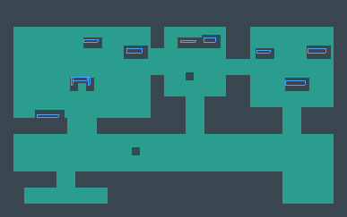
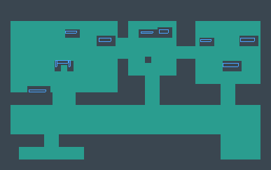
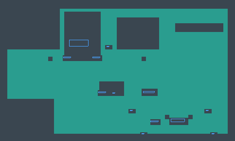

# Revisión de colisiones

Generado por `tools/probar_colisiones.gd` (prueba física: cuadrícula de 8 px con la forma de los pies de Sami, 14 x 8). Es un informe automático, no se edita a mano.

## Nivel 1

Mapa de 1024x640 px: 5373 celdas libres, 5373 alcanzables desde el punto de salida (272.0, 444.0).

| Objeto | Colisión (ancho x alto px) | Celdas alcanzables dentro de la base | Resultado |
|---|---|---|---|
| Prop_Mesa (mesa) | 60 x 26 | 0 | ok |
| Prop_Sofa (sofa) | 72 x 25 | 0 | ok |
| Prop_MuebleTV (mueble_tv) | 50 x 22 | 0 | ok |
| Prop_Estante_D1 (estante) | 51 x 27 | 0 | ok |
| Prop_GasEstufa_D3 (gas_estufa) | 52 x 19 | 0 | ok |
| Prop_Nevera (nevera) | 43 x 25 | 0 | ok |
| Prop_CuadroCama_D2 (cuadro_cama) | 65 x 27 | 0 | ok |
| Prop_Repisa_D4 (repisa) | 47 x 20 | 0 | ok |
| Prop_Armario (armario) | 61 x 27 | 0 | ok |
| Prop_PuertaSalida (puerta_salida) | en el hueco de la pared | 0 | ok |

Mesa: 16 celdas alcanzables dentro de la zona segura (el hueco de abajo); se llega por delante: sí.

| Interactivo | Lados desde los que se puede usar | Resultado |
|---|---|---|
| Prop_Estante_D1 | arriba, izquierda, derecha, abajo | ok |
| Prop_GasEstufa_D3 | izquierda, arriba, derecha, abajo | ok |
| Prop_CuadroCama_D2 | arriba, izquierda, derecha, abajo | ok |
| Prop_Repisa_D4 | arriba, derecha, izquierda, abajo | ok |
| Prop_Armario | arriba, izquierda, derecha, abajo | ok |
| Prop_PuertaSalida | arriba, izquierda, abajo, derecha | ok |
| Npc_Marta | arriba, izquierda, derecha, abajo | ok |
| Npc_Lucia | arriba, izquierda, derecha, abajo | ok |

- Zona `Zona_Mesa`: alcanzable
- Zona `Zona_Ventana`: alcanzable
- Zona `Zona_Puerta`: alcanzable
- Zona `Zona_Escalera`: alcanzable

Empuje: Sami puesto dentro de `Prop_Sofa`: dentro = sí; después de `sacar_de_colision()` libre = sí, movido 19 px.

## Nivel 2

Mapa de 1024x640 px: 5382 celdas libres, 5382 alcanzables desde el punto de salida (368.0, 316.0).

| Objeto | Colisión (ancho x alto px) | Celdas alcanzables dentro de la base | Resultado |
|---|---|---|---|
| Prop_Mesa (mesa) | 60 x 26 | 0 | ok |
| Prop_Sofa (sofa) | 72 x 25 | 0 | ok |
| Prop_MuebleTV (mueble_tv) | 50 x 22 | 0 | ok |
| Prop_Estante_D1 (estante) | 51 x 27 | 0 | ok |
| Prop_GasEstufa_D3 (gas_estufa) | 52 x 19 | 0 | ok |
| Prop_Nevera (nevera) | 43 x 25 | 0 | ok |
| Prop_CuadroCama_D2 (cuadro_cama) | 65 x 27 | 0 | ok |
| Prop_Repisa_D4 (repisa) | 47 x 20 | 0 | ok |
| Prop_Armario (armario) | 61 x 27 | 0 | ok |
| Prop_PuertaSalida (puerta_salida) | en el hueco de la pared | 0 | ok |

Mesa: 16 celdas alcanzables dentro de la zona segura (el hueco de abajo); se llega por delante: sí.

| Interactivo | Lados desde los que se puede usar | Resultado |
|---|---|---|
| Prop_GasEstufa_D3 | izquierda, arriba, derecha, abajo | ok |
| Prop_PuertaSalida | arriba, izquierda, abajo, derecha | ok |
| Npc_Marta | arriba, izquierda, derecha, abajo | ok |
| Item_Zapatos | arriba, izquierda, derecha, abajo | ok |
| Item_Mochila | arriba, izquierda, derecha, abajo | ok |
| Item_Linterna | arriba, izquierda, derecha, abajo | ok |

- Zona `Zona_Mesa`: alcanzable
- Zona `Zona_Ventana`: alcanzable
- Zona `Zona_Puerta`: alcanzable
- Zona `Zona_Escalera`: alcanzable

Empuje: Sami puesto dentro de `Prop_Sofa`: dentro = sí; después de `sacar_de_colision()` libre = sí, movido 19 px.

## Nivel 3

Mapa de 1280x768 px: 9103 celdas libres, 9103 alcanzables desde el punto de salida (176.0, 316.0).

| Objeto | Colisión (ancho x alto px) | Celdas alcanzables dentro de la base | Resultado |
|---|---|---|---|
| Prop_Edificio (edificio) | 112 x 45 | 0 | ok |
| Prop_Escombros (escombros) | plano, sin colisión | 0 | ok |
| Prop_Barrera1 (barrera) | 47 x 20 | 0 | ok |
| Prop_Barrera2 (barrera) | 47 x 20 | 0 | ok |
| Prop_Poste (poste) | 21 x 14 | 0 | ok |
| Prop_Barrera3 (barrera) | 47 x 20 | 0 | ok |
| Prop_Carro (carro) | 70 x 25 | 0 | ok |
| Prop_Arbol1 (arbol) | 21 x 14 | 0 | ok |
| Prop_Arbol2 (arbol) | 21 x 14 | 0 | ok |
| Prop_Arbol3 (arbol) | 21 x 14 | 0 | ok |
| Prop_Arbol4 (arbol) | 21 x 14 | 0 | ok |
| Prop_Arbol5 (arbol) | 21 x 14 | 0 | ok |
| Prop_Banca (banca) | 50 x 20 | 0 | ok |
| Prop_Carpa (carpa) | 83 x 28 | 0 | ok |

| Interactivo | Lados desde los que se puede usar | Resultado |
|---|---|---|
| Npc_Rosa_D12 | arriba, izquierda, derecha, abajo | ok |
| Npc_Tomas_D14 | arriba, izquierda, derecha, abajo | ok |
| Npc_Marta | arriba, izquierda, derecha, abajo | ok |
| Npc_Lucia | arriba, izquierda, derecha, abajo | ok |

- Zona `Zona_Peligro_D13`: alcanzable
- Zona `Zona_Cable`: alcanzable
- Zona `Zona_Llegada`: alcanzable

Empuje: Sami puesto dentro de `Prop_Carro`: dentro = sí; después de `sacar_de_colision()` libre = sí, movido 14 px.

## Resultado

**Todo se cumple.**

